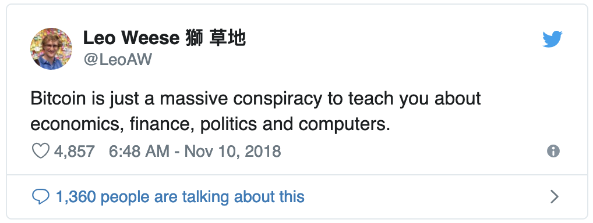

## Context

This is going to be a boring article describing my journey of becoming an Ethereum developer and, as
a bonus, my thoughts on the abstract parts of the blockchain movement.

In mid-2017, I coded my first ever smart contract, but it took me a while to put an end to my other
endeavors and fully jump on the blockchain bandwagon, with a prominent focus on Ethereum. After more
than a year, I thought it'd be a good moment to log my progress. Should be fun, I guess.

## The Why

Couldn't have said it better (other than referring to blockchains rather than Bitcoin alone), yet
there is a catch. I — and I guess I'm not alone — learned a couple of finance 101 life-long lessons.
What can go up fast, can plummet even faster. Never invest more than you can afford to lose and
always hedge your investments. You know the drill, kids.

The speculative phase didn't last for long though. Fast forward a few months later and I'm watching
Youtube videos on Merkle trees and what not because I'm a geek and engineer by heart and I love to
understand stuff.

> Shouldn't take more than a few days. I'd be back to my crazy entrepreneurial goals in no time!

Well, that didn't work as expected… because it's been 12 months and I'm still on the same learning
curve! What I do know though is that I topped up my computer science game, went through a dozen
white papers, got my feet wet with [economics](/posts/2018/radical-markets/) by reading a few books
and met a lot of insightful people I had great time with.

This had never happened before. I worked as an
[mobile and backend freelance engineer](https://www.behance.net/PaulRBerg),
[built start-ups](https://www.linkedin.com/in/paulrberg/) and constantly got involved in various
business-ish communities, but nothing had the same elusive yet dynamic vibe.

As highlighted before, I want to emphasize again that blockchains are a hotchpotch of:

- Economics
- Computer Science
- Mathematics
- Politics
- Law and Finance (marginally)

And this is exactly the reason I made the switch. Each subject is a holistic component and they
beautifully form the basis of a new methodology to coordinate people across large distances and
times. For instance, we imagine jobs as being vertical and narrowly focused because Smith revealed
that self-interest and specialization pay off. Maybe for the first time after a while, we witnessed
a steady, continuous boost of the importance of educated generalism.

## Unstable Assumptions

A leitmotif of the blockchain ecosystem is the perpetual process of challenging assumptions.

Starting with the Bitcoin white paper in 2009, all along towards the 2018 sharding quarrels over
Ethereum 1.x and 2.0, the community's been comprized of a bunch of Sapiens who love to challenge the
status-quo — **when there's justified economic, algorithmic and cryptographic justifications in
support of the new model**.

Studying blockchains, I learned to be more open but critical at the same time. I now take with a
grain salt anything anyone says because objective discourse is rarely articulated; more often than
not, what trumps is particular polarizations which (1) are backed by game-theoretical incentives or
(2) are pure dogma.

Nevertheless, I strive to believe that an open-minded, technical, socially-aligned group which bases
its work on sound economic principles has the potential to build coordination mechanism which can
deprecate nation states, ceteris paribus. One bottleneck though is that we're facing a gargantuan
number of unknown unknowns out there.

## Long-Term Goals

To be fair, no one anyone has truly figured it out where we want blockchains to fit in the world's
political agenda. It seems that the phenomenon has just matured after living in a nest for a long
time — and now everyone's confused on what's the optimal path forward. It could be just we're
creating a more open, transparent financial system where corporations merely run their backend on
Ethereum, Polkadot et al. Still a massive improvement indeed, but it'd be somehow “meh”.

On the flip side, the whole industry could escalate into a new socio-political environment where the
efficient market hypothesis primes and there's much less inequality on our little blue dot in the
Universe. [Radical Markets](http://radicalmarkets.com) has just been published this year and I
genuinely find it striking that the political-economic proposals of the book have been concocted in
parallel with blockchain. I reckon that's why [Vitalik Buterin](https://medium.com/@VitalikButerin)
has invited [Glen Weyl](https://medium.com/@glenweyl) to
[speak at every major conference](https://slideslive.com/38911680/decentralization-against-isolation)
since he [laid out his thoughts](https://vitalik.ca/general/2018/04/20/radical_markets.html) on a
pre-copy of the book in April.

Keen to keep an eye on Radical Markets over the following years. Although I'm intrigued by many of
its propositions— and I always aim to stay open-minded to new ideas — attaining the said goals in
the book would require coordination of multiple actors and a lot of individuals willingly giving up
a lot of financial power. Check out my
[introduction to Radical Markets](/posts/2018/radical-markets/) if this seems interesting to you.

You might also want to take a look at:

1. [Democracy.Earth](https://www.democracy.earth)
2. [Circles UBI](https://joincircles.net)

## Pastimes

You might wonder what the heck I'm actually doing.

### Ethereum-related

- [Writing smart contracts in Solidity](https://github.com/PaulRBerg)
- [Bounty hunter](https://gitcoin.co/profile/PaulRBerg), [freelancer](https://behance.net/PaulRBerg)
  and
  [hackathon wanderer](https://devpost.com/PaulRBerg?ref_content=user-portfolio&ref_feature=portfolio&ref_medium=global-nav)
- Contributing to various Ethereum
  [codebases](https://github.com/ethereum/go-ethereum/pulls?utf8=%E2%9C%93&q=is%3Apr+author%3APaulRBerg+)
  and [forums](https://ethresear.ch/u/PaulRBerg/activity)
- Contributing to the Ethereum
  [Q&A StackExchange](https://ethereum.stackexchange.com/users/24693/paul-berg)
- Independently researching stuff , with a
  [recent focus on zero-knowledge proofs](https://ethresear.ch/t/zero-knowledge-proofs-starter-pack/4519)
- Running an [Ethereum community in Romania](https://www.facebook.com/EthIasi)
- Daily #CryptoTwitter participant

### Chronos Protocol

Just at the margin of Ethereum, I'm spending my time building a
[money streaming protocol](https://twitter.com/ChronosProtocol). It's very much early-stage, but I'm
striving hard to make long-term financial commitments more efficient and fair for consumers. An
ancillary component of Chronos Protocol is [ERC1620](https://github.com/ethereum/EIPs/issues/1620),
which describes a standard of **making money a function of time** on EVM-compatible chains.

> If you're working remotely, freelancing, running a business and paying employees, paying a monthly
> rent, or, generally, have any sort of subscription anywhere, give me a shout! I'm glad to help
> people integrating continuous payments on Ethereum for free.

## Wrap-Up

Ethereum and blockchains are a super duper cool place to test your self-learning skills and openness
to new ideas.

I cannot tell whether any present-day distributed ledger tech will still be around in the next
century or so, but they will definitely have a huge influence on the next iterations of trustless
computing platforms nonetheless.

Meanwhile, there's a lot of [work](https://github.com/ethereum/eth2.0-specs) to be done and there
are never enough people onboard! Feel free to join the hive. Find me on
[Twitter](https://twitter.com/PaulRBerg) if you want to chat.

### Credits

- [Ethereum Foundation](https://ethereum.org) for the leading graphic
- [Mattias Russo-Larsson](https://unsplash.com/@mattiasrl) on
  [Unsplash](https://unsplash.com/photos/GQ8JIFHHmCg)
