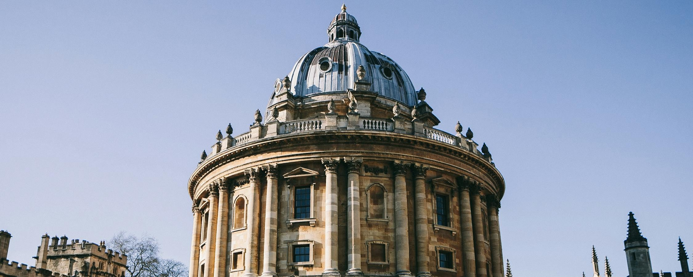

My first psychedelic trip was one of the top 5 most amazing experiences of my life. Here's the story
of how I did it, how it changed me, and the lessons I took away from it.

## The Set & Setting

It was November 2023, and I was traveling solo in Oxford, UK. I was given the chance to try ~150μg
of LSD. My curiosity took over, and after making sure I was properly prepared, I decided to go for
it.

It turned out to be one of the best decisions I've ever made.

## The Trip

The next 10 hours were pure, blissful magic.

I wandered through Oxford, spending hours just sitting on park benches and observing the world
around me.

I noticed tiny details about the people passing by that I'd never seen before, like the subtle tints
and shades of their clothing accessories.

The buildings? Astoundingly beautiful. I'd walked by them many times without really seeing them, but
that day was different. I must have stared at the Bodleian Library for a good 15 minutes.

Time seemed to stretch and slow down, and I almost forgot that there was a 'me' in all this. My body
felt lighter.

Back at my Airbnb, I started watching nature videos on YouTube. I did literally just that for a
couple of hours, and I enjoyed every second. I was happy simply to exist.

As the effects began to wane after 5 or 6 hours, I had some fruit, then spent the rest of the
evening reflecting on the experience. Trying to describe it all feels impossible—psychedelic trips
are ineffable, meaning they cannot be put into words. It's a deeply subjective experience, i.e.,
qualia.

For a week or two after the trip, I floated in what's known as an 'afterglow.' I was basically in a
happy mood all the time.

## Trait Changes

It's been seven months since my trip, and I've experienced some lasting changes:

- I meditate daily for 10 minutes.
- I quit alcohol. It messes with sleep and I don't see the point anymore.
- I enjoy other people's company more.
- I am calmer and more present.
- I am less judgmental.
- I get out of bad moods faster.

There may be confounders, since I embarked on a health-oriented lifestyle several years ago, but
many of these traits kicked in shortly after my trip. It seems unlikely to be a coincidence.

As Peter Attia says, psychedelics fall into the category of drugs that alter both short-term states
and long-term traits.

## Takeaways

- Life is more fun when you drop your ego and become more present.
- The opposite of spirituality isn't materialism; it's egoism.
- I didn't meet God or anything—I'm still an atheist. Psychedelics can be explored scientifically.
  During a trip, the parts of your brain linked to your ego shut down.
- That we can have psychedelic experiences is an astonishing fact, which also shows how little we
  understand consciousness.
- Before, I believed there was only one 'mode' of consciousness. Now, I think we're just scratching
  the surface of the various possible modes of consciousness.
- I conjecture that AGIs will be able to experience psychedelic trips, too.

## Recommended Reading

If you're curious about psychedelics, I can't recommend Michael Pollan's
"[How to Change Your Mind](https://www.amazon.com/Change-Your-Mind-Consciousness-Transcendence/dp/1594204225)"
enough. The breadth and depth of his research are spectacular.

Another great read is Professor David Nutt's
"[Psychedelics](https://www.amazon.com/Psychedelics-Revolutionary-Change-Life_A-Expert/dp/0306835282)".
Professor Nutt has been advocating for psychedelics for years.

Perhaps my favorite explanation for what psychedelics do is
[Alison Gopnik's](https://x.com/AlisonGopnik) theory that they temporarily reset your brain to a
state similar to a baby's, full of wonder and new perceptions. It's like hitting the reset button.

P.S. I don't recommend taking psychedelics alone like I did. Always have a trusted friend with you
as a sitter. Set and setting are crucial to avoid bad trips.

P.P.S. Do your own research on safety.
