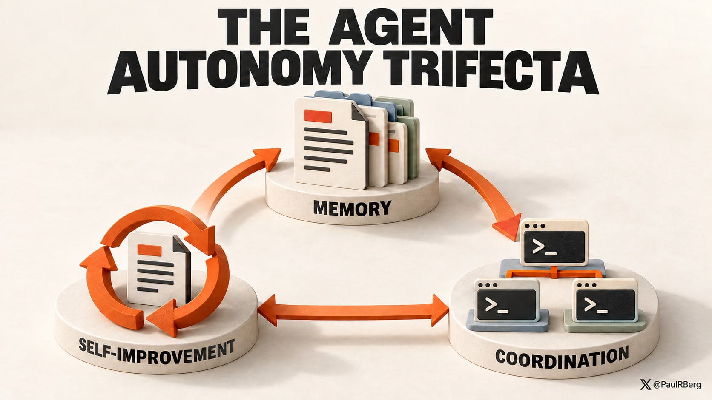
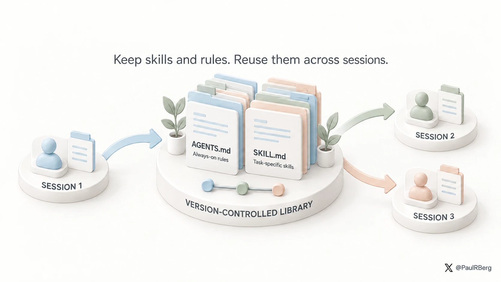
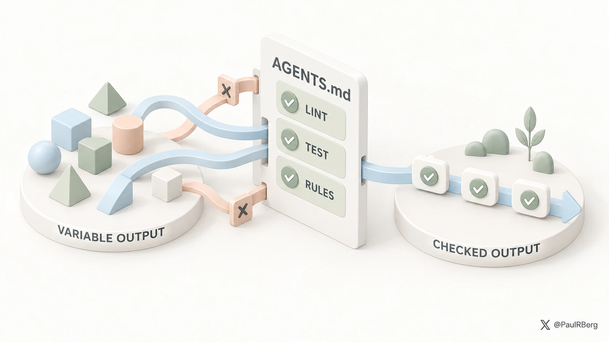
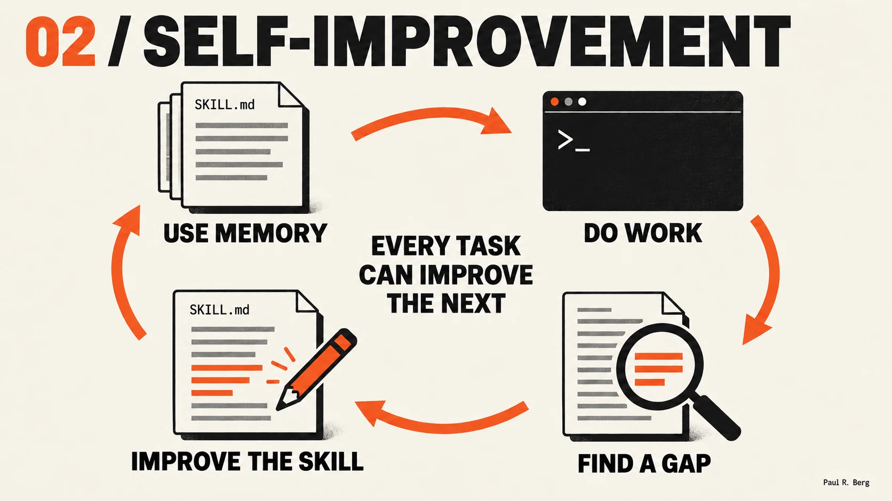
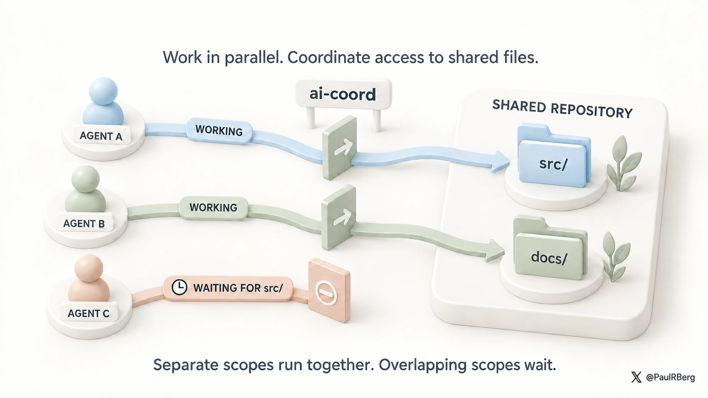
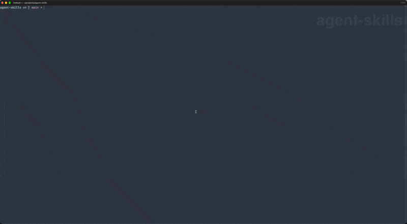
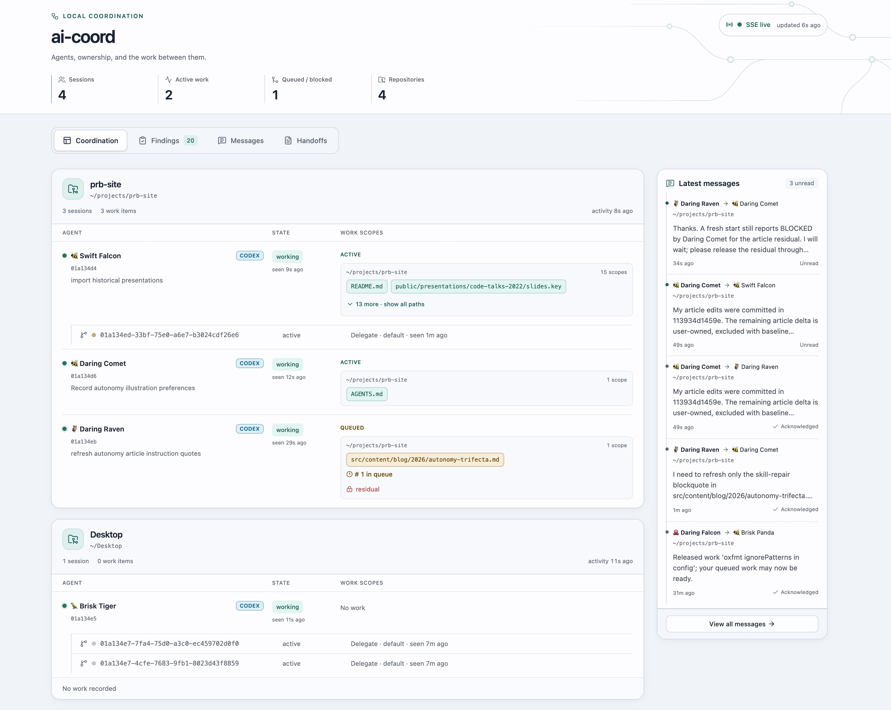

import LinkPreview from "@/components/LinkPreview.astro";
import autonomyTrifectaPreview from "@/assets/link-previews/autonomy-trifecta.png";
import agentSkillsPreview from "@/assets/link-previews/agent-skills.png";



The power of agentic engineering dawned on me in June 2025. I was immediately hooked. A few months
later, I was spending all day in Claude Code, and then Codex.

I've spent copious amounts of time (to the point of developing a slight addiction) refining my AI
agents to get maximum productivity out of this wonderful technology. I think others will find my
learnings useful.

This article is aimed at software engineers and technical operators. I've strived to write it in a
timeless way, focusing less on specific harness features (or lack thereof) and more on general
principles for building a modern, autonomous agentic stack.

## TL;DR

Ask your agent to install this skill — it will review your agent setup and install the autonomy
trifecta:

<LinkPreview
  href="https://github.com/PaulRBerg/autonomy-trifecta"
  image={autonomyTrifectaPreview.src}
/>

## The Trifecta

An autonomous AI agent system is one with three properties:

1. **Persistent Memory**: version-controlled library of reusable skills and `AGENTS.md` files
2. **Reflexivity**: recursive self-improvement over those memory files
3. **Scalable Parallelization**: multiple agents can work in parallel, safely and productively

I'll go through each of those properties, but first, a few words about the harness.

## Know Thy Harness

I use [Codex CLI](https://learn.chatgpt.com/docs/codex/cli) and
[Claude Code](https://claude.com/product/claude-code), and occasionally, when I dabble with other
models, I spin up [Oh My Pi](https://github.com/can1357/oh-my-pi). These harnesses load their
configs from `.agents/`, `.codex/`, and `.claude/`, but your harness may use a different folder.

I keep my global agent configuration in version control, and I recommend you do the same:

- [`dot-codex`](https://github.com/PaulRBerg/dot-codex) - Codex config
- [`dot-claude`](https://github.com/PaulRBerg/dot-claude) - Claude Code config
- [`dot-agents`](https://github.com/PaulRBerg/dot-agents) - generic fallback for all harnesses

These global folders are a core part of your agents' brain. Keeping them in version control enables
greater visibility into how your agents have changed over time, and makes it easier to pinpoint
problems when they arise.

Make sure to `.gitignore` sensitive files/folders. Harness developers tend to bloat these folders
with things that should not be in version control, including auth tokens and the like.

## Property 1: Persistent Memory



### Primacy of Agent Skills

[Agent Skills](https://agentskills.io) are a major innovation. The idea is simple, but powerful:

> Agent Skills are a lightweight, open format for extending AI agent capabilities with _specialized_
> knowledge and workflows.

'Specialized' is the key term.

Skills give us leverage. They act as a force multiplier by not clogging up the context window of
your LLM (200k, 1M tokens, etc.). Knowledge is chopped up, packaged up, and used on the fly
(according to the task at hand).

To make the most of agent skills, you need to keep track of them and treat them as your digital
bonsai trees — which have to be groomed and pruned with care!

This is the single most important thing you can do right now: set up **your own AI agent skills
library**. Mine is at:

<LinkPreview href="https://github.com/PaulRBerg/agent-skills" image={agentSkillsPreview.src} />

Whether you create this library as a separate repo (as I did) or you embed the skills within a
`~/.agents` or `~/.claude`, that is an implementation detail. The point is, you should have a place
where your AI agent skills are stored. Think of these skills as crystallized knowledge — knowledge
that is easily reusable and (very importantly) that your agents don't have to rediscover on the fly.

You should use version control (e.g., git) for this library of skills. That's super important, as
you will see later on in the _Reflexivity_ section.

#### Sharing Skills in a Team

Every team/organization should have its bespoke `<ORG-NAME>/agent-skills` repository, and all
employees should install it and make continuous improvements to it.

And of course, you should keep your personal skill library separate from your company's.

#### Per-Project Skills

It's up to you to decide whether a skill goes into a global library (personal or organizational), or
a relative `.agents/skills` folder in a specific project/repo.

You could, in principle, ask your agents to figure that out for you, but it's the kind of thing that
can devolve into slop.

Plus, knowing what skills to use and in which context is basically our job now, as human operators.
Language models have got intelligent enough that they activate skills in the right context, but if
you really want to be as productive as possible, explicitly invoking skills in your prompts is the
way to go. It's the difference between a good manager and a bad manager. A good manager knows off
the top of their head who to delegate the task to!

### AGENTS.md

`AGENTS.md` files are powerful. They play a key role in building an autonomous stack.

If agent skills are _contextual_ (they apply to some AI chats in a project), `AGENTS.md` files are
_universal_ (they apply to every AI chat in a project). There is also a global `~/.agents/AGENTS.md`
file (or, equivalently for Claude Code, `~/.claude/CLAUDE.md`), which is loaded in every single
chat, regardless of the project.

This is what I recommend putting in these files:

| Content             | Example                                           |
| :------------------ | :------------------------------------------------ |
| Code linting        | ESLint, etc.                                      |
| Testing             | Vitest, etc.                                      |
| Change Management   | Auto-push to remote, auto-sync other repositories |
| Hard-and-fast Rules | Keep files under 1000 lines of code               |

As you can see, `AGENTS.md` files are about **constraints** and **always-on rules**. LLMs, by their
very nature, are probabilistic. `AGENTS.md` is how we turn that probabilistic haze into
deterministic output.



### Choose Your Own Adventure

It's up to you to decide what rules to enforce, and which software to run for those checks. The
important thing is: proactively think about this. Different projects and problem situations require
different checks!

For example, my personal finance dashboard is written in TypeScript. I lint that TypeScript code
with ESLint. In another project, I use Blender for the 3D modeling of a house. There, I use a Python
rendering library to enforce certain construction invariants, such as adhering to local construction
regulations. These rules are embedded in the `AGENTS.md` file of each repo.

Globally, I enforce things like git commit management, e.g., I want my agents to commit as soon as
they complete a task, and also to push to the remote. You might not want it to work like this,
though. And that's fine!

Other people do other things. For example, Uncle Bob runs a
[CRAP metric](https://github.com/unclebob/crap4java) check on his agents.

### Who Writes My Skills and AGENTS.md Files?

I used to author them by hand. Not anymore. Language models have got sufficiently intelligent (e.g.,
Claude Fable, GPT-6, etc.) that they can write these themselves. You just have to prompt them into
existence[^1] by giving detailed instructions.

I have a skill called
[`agents-brain`](https://github.com/PaulRBerg/agent-skills/tree/main/skills/agents-brain) that
handles:

- Skill creation + maintenance
- `AGENTS.md` creation + maintenance

When I create a skill, I explicitly invoke `agents-brain`, and I say something like "Use
/agents-brain to create this skill that does this and that".

### When to create a skill?

You create a skill when you notice yourself typing the same prompt again and again.

## Property 2: Reflexivity (or Recursive Self-Improvement)



We have our agent skills library properly set up, and a neat collection of constraints and rules
written in `AGENTS.md` files. What's next?

Enter the principle of reflexivity: we instruct our AI agents to recursively maintain and improve
our agent skills library as they work on various projects on our computer.

This can be accomplished in a variety of ways. I do it by putting instructions like this in my
global `~/.agents/AGENTS.md` file:

```markdown
If using one of my personal skills reveals a problem below, make the smallest durable improvement to
that skill:

- Outdated information or a bug.
- Unclear or missing instructions.
- Missing functionality within the skill's purpose.
- Avoidable manual work.

This standing authorization permits maintenance of `~/projects/agent-skills` from any repository,
including during questions, research, reviews, and otherwise read-only tasks. In Plan Mode,
investigate and include the repair in the plan without editing.
```

How this rule is worded is an implementation detail. The point is to put something like that in your
global `AGENTS.md`, and then watch your agents magically keep their brain updated, autonomously.
You're no longer a meat proxy :)

### Continuous Code Review/Polish

Reflexivity need not end at Markdown files.

You can instruct your agents to continuously run a code review/code polish skill after making code
changes.

Again, sharing the rule from my global `AGENTS.md`:

```markdown
After every medium or large code change, run `$code-polish` on this session's changed code before
committing. Judge size by scope and behavioral complexity, not line count. Skip it for small,
localized changes unless I explicitly request it.
```

### The Sky is the Limit

You can apply the principle of recursive self-improvement to any files that are of interest to you:
diagrams, documentation files, or whatever.

Think of it like this — every interaction with an AI agent running on your machine is an opportunity
to discover errors in your code base/project files. Why not fix them on the spot?

## Property 3: Scalable Parallelization



_This is one of the more advanced workflows. If you run only one agent at a time, you can skip
this._

I run multiple agents in parallel, often on the same repo. I do this using iTerm split panes:



I like split panes a lot. It's easy to spawn a new pane using CMD+D, and then close one using CMD+W.
I find it a whole lot easier than using terminal multiplexers like `tmux` or
[`zellij`](https://github.com/zellij-org/zellij).

At any rate. If you run agents in parallel, you surely have faced the problem of agents stepping on
each other's toes. That is, agent B discarding agent A's work.

### Git Worktrees Suck

Git worktrees are a traditional solution to this parallelization problem.

However, I can't stand them, and I don't recommend using them!

1. They don't prevent merge conflicts. They only **defer them**.
2. They increase the cognitive overload of both humans and agents by creating multiple folders
   pointing at the same repo.

So, I wondered — isn't there an easier way of achieving parallelization without the overhead of git
worktrees?

### `ai-coord` CLI

I came up with this idea for a
['coordination' CLI](https://github.com/PaulRBerg/agent-skills/tree/main/toolkit/coord), which I now
use every day. Here's how it works:

- Agents give themselves names
- Agents notify other agents about the specific files/folders they will be working on (not
  necessarily within the same repo; they have autonomy on my machine)
- If another agent is already working on some or all those files, the original agent is informed
  about it, and they will start waiting to obtain ownership
- Agents give themselves funny names and have the ability to message each other (this is just for
  better UX)

And I monitor their coordination via a localhost dashboard UI:



You can think of `ai-coord` as a 'traffic control' system, or a 'semaphore'. Agents are constrained
to wait for other agents, just like drivers in traffic wait for other drivers ahead of them, obey
traffic lights, and so on.

## Access Control

A note on access control — I run my agents in YOLO mode.

Apart from some commands and paths they are blocked from accessing (the exact rules are
harness-dependent and hence outside the scope of this article), my agents can read from or write to
any folder on this machine. They can also make network requests and otherwise access the Internet
freely.

You might not be in a position to grant so much freedom to your agents. Your company may require
stricter controls, or you may be more risk-averse.

But that's fine. The autonomy trifecta can be implemented in an agentic setup with more granular
access controls (see the
[principle of least privilege](https://en.wikipedia.org/wiki/Principle_of_least_privilege)). It does
take more time to do it, though, and your agents' performance[^2] might be affected as a result.

## Examples of Projects

Projects my agents are working on:

- Maintaining Sablier's [frontend](https://app.sablier.com/) (crypto payment software)
- Personal finances, accounting, tax reports
- Monitoring my investment portfolio
- 3D modeling a house, in Blender
- Searching my email history
- Email drafting (using the [`gws`](https://github.com/googleworkspace/cli) CLI)
- Selling on Ebay and Vinted (I paste an image of a product into a chat, and the AI figures out the
  pricing and posts the ad)

And I could go on and on. I haven't written a single line of code in any of the projects mentioned
above.

## Ending Thoughts

For a long time, I've thought that a hallmark of a good code base is that it's easy to make changes
and add new features. Or, more poetically, a code base is good **if and only if** it is metamorphic.

I think that principle has always held true. But now, in the age of agentic engineering, it's truer
than ever — since changes/features can be implemented faster than ever.

Thanks for reading. If you find this helpful, please share it on social!

If you'd like to book me to review your business workflows and automate them,
[reach out via email](mailto:prberg@proton.me) or [X](https://x.com/PaulRBerg).

## References

- [Agent Skills](https://github.com/PaulRBerg/agent-skills): my skills library
- [Dot Codex](https://github.com/PaulRBerg/dot-codex): my Codex CLI config
- [Dot Claude](https://github.com/PaulRBerg/dot-claude): my Claude Code config

[^1]:
    The skeptical among you might retort by saying, "but then, what's the point of skills? If agents
    do it anyway, why not let agents figure it out on the fly?" The answer is simple: more leverage.
    Explaining what a skill should do takes time and multiple prompts. Afterward, invoking a skill
    is simple. It's a few words!

[^2]:
    The performance of your agents also depends on how much access they have to your data, the
    quality of your data, and the tools they can use. For brevity, I didn't touch on this topic, but
    you should ensure your agents can access your services/databases (e.g., via an MCP). An agent
    that cannot access your financial transactions can only go so far in generating an accurate tax
    report.
